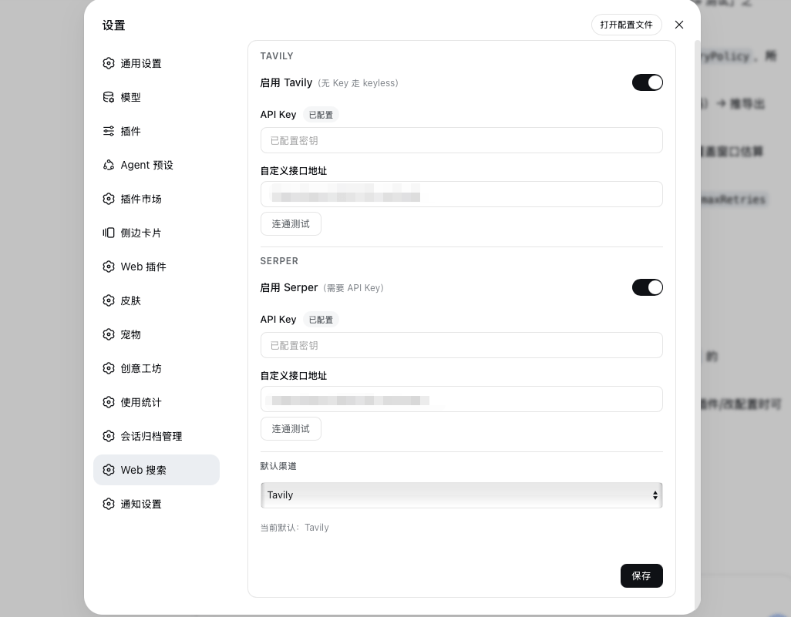

# dsh-web-search

[中文](README.md) | English



Multi-channel web search for [DeepSeek Harness](https://github.com/deepseek-ai/deepseek-harness): **Tavily + Serper** as a single composite provider. Configure both channels simultaneously, switch the default channel on the fly, or turn both off to fall back to official DeepSeek search.

## Install

npm:

```sh
dsh plugin --profile web add dsh-web-search
```

Or follow GitHub:

```sh
dsh plugin --profile web add github:m-dsh/dsh-web-search
```

Requires DSH `0.2.0-rc.2` or newer. Settings → **Web Search**: toggle each channel, enter API keys, set custom URLs, and test connectivity. Use the dropdown to pick the default channel when both are on — or just enable one. Toggles, URLs, and the default channel save and apply instantly; use "Save" for API keys. Settings use `configForms` with profile entry `web-search`; access the page through localhost on the DSH computer.

Remove:

```sh
dsh plugin --profile web remove dsh-web-search
```

> `dsh.bundle` · prebuilt `lib/` · git install does not need `allowBuilds`
